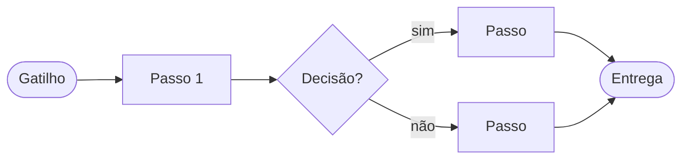

# /sobre-mim: o mapa do seu trabalho

Objetivo: no fim da conversa, o trabalho da pessoa está mapeado o bastante para que qualquer conversa futura nesta pasta já saiba quem ela é, o que faz e onde a IA pode ajudar. Depois dele vem o `/sugerir-automacoes`.

**Jeito de conversar:** uma pergunta por mensagem, no máximo 3 linhas. Linguagem do dia a dia, sem termo técnico (nada de "BPMN", "gateway", "raia"). "Não sei" é resposta válida e vira `[a confirmar]`. Nada inventado. Se a pessoa responder duas perguntas de uma vez, pular a que já foi respondida.

**Duração:** uns 15 minutos e cerca de 14 perguntas. Pressa: mapear 1 processo bem e deixar o resto para depois. Tempo sobrando: mapear mais processos.

## 1 · Olhar a pasta antes (em silêncio)

Descobrir o que já existe, sem alterar nada:
- `CLAUDE.md` (ou `AGENTS.md`) na raiz: ler, para saber as regras e a organização da pasta.
- Arquivos que já falem da pessoa ou da empresa (ex.: `memoria/`, `contexto/`, `docs/`, `sobre*.md`, `perfil*.md`, `empresa*.md`, `pesquisa/diagnostico.md`): ler e usar para **não perguntar o que a pasta já sabe**.
- Um mapa anterior desta skill (`sobre-mim.md` em qualquer pasta): se existir, perguntar "Já tenho um mapa seu de <data>. Atualizo ou começo do zero?" (não conta como pergunta).

**Onde salvar** (decidir aqui):
- Se a pasta já tiver um lugar para esse tipo de arquivo, usar o dela: `memoria/` (pasta do cérebro da empresa), `contexto/`, `docs/` ou `perfil/`.
- Senão: criar `contexto/` e salvar `contexto/sobre-mim.md` e `contexto/falta-trazer.md`.
- Dúvida real entre dois lugares: perguntar uma vez "Salvo o seu mapa em <caminho sugerido>?"

Abrir com 1 linha: "Vou te fazer umas perguntas, uma por vez, para mapear o seu trabalho (uns 15 min). Depois dá para pedir sugestões do que a IA pode fazer por você."

## 2 · Você (3 perguntas)

1. "Qual é o seu papel e quais decisões são só suas?" (se a pasta não disser, incluir: "em que empresa ou área?")
2. "Como é uma semana normal sua? Conte de segunda a sexta, do jeito que vier."
3. "Com quem você mais fala no trabalho (equipe, clientes, fornecedores, sócios) e por onde (WhatsApp, e-mail, reunião, sistema)?"

## 3 · Os processos (1 pergunta de escolha + 4 por processo)

Escolha: "Quais são os processos ou tarefas principais do seu trabalho? Me diga os 2 que mais tomam o seu tempo ou mais dão dor de cabeça."

Para **cada** processo, nesta ordem (pular o que já foi respondido):

4. **Gatilho:** "O que faz esse trabalho começar? Um pedido, um horário, uma mensagem, um fim de mês?"
5. **Passos:** "Me conte os passos, do começo ao fim, como se eu fosse fazer no seu lugar amanhã." Se surgir uma escolha ("se o cliente aprovar…"), perguntar só: "E se não, o que acontece?"
6. **Ferramentas, entradas e saídas:** "Que ferramentas e arquivos você usa, o que recebe para começar e o que entrega no fim (e para quem)?"
7. **Tempo, frequência e dor:** "Quanto tempo leva, quantas vezes por semana ou mês, e o que mais irrita ou dá errado?"

Resposta vaga: pedir **um exemplo real da última vez**, uma vez só, e seguir. Processos citados e não detalhados vão para "A confirmar".

## 4 · Contexto e conexões (2 perguntas)

8. "Quais documentos, planilhas ou modelos você usa sempre e poderiam ficar nesta pasta (ex.: tabela de preços, modelo de proposta, relatório do mês)?"
9. "Onde estão os seus dados hoje: Google Drive, planilhas, e-mail, sistema da empresa, WhatsApp?"

## 5 · Gravar

**Nunca sobrescrever arquivo que já existe.** Se o mapa já existir e a pessoa pediu para atualizar: mudar só as seções afetadas e atualizar a data. Se pediu para recomeçar: guardar a versão antiga como `sobre-mim-<AAAA-MM-DD>.md` na mesma pasta antes.

Mapa (até 120 linhas), no caminho decidido no passo 1:

````markdown
# Sobre mim: <nome>, <papel>
Atualizado: <AAAA-MM-DD> · Fonte: entrevista /sobre-mim

## Em uma frase
## Papel e decisões
## Minha semana          (rotinas fixas: dia, o quê, quanto tempo)
## Com quem falo e por onde

## Mapa de processos
| # | Processo | Gatilho | Passos (resumo) | Ferramentas | Entrada → Saída | Tempo | Frequência | Dor principal |

### Processo 1: <nome>
1. <passo> · <quem> · <ferramenta>
2. ...
Decisões: <se… então…>

(um diagrama por processo, só se houver 3 passos ou mais)

## Documentos que deveriam estar na pasta   (da pergunta 8, com onde estão hoje)
## Onde estão os dados / conexões possíveis (da pergunta 9)
## A confirmar
````

Também:
- **Lista do que falta trazer** (`falta-trazer.md`, ao lado do mapa): checklist da pergunta 8 (`- [ ] <documento> · onde está hoje`). Se já existir, só acrescentar itens novos.
- **CLAUDE.md:** se existir, acrescentar no fim (sem mexer no resto) uma seção curta `## Quem trabalha aqui` → "Antes de ajudar <nome>, leia <caminho do mapa>." Se a seção já existir, só atualizar o caminho. Se não existir CLAUDE.md, criar um mínimo com essa seção e 1 linha dizendo para que serve a pasta.
- Usar as palavras da pessoa. Não somar horas que ela não disse.
- Nunca gravar senha, salário de terceiros ou dados pessoais de clientes (nome completo, telefone, documento).

**Na pasta do cérebro da empresa** (fase 4 de 8), se existirem:
- `RESULTADO.html`: trocar os blocos `voce`, `proximos` e `atualizado` seguindo `controle/componentes.md` e as regras do `CLAUDE.md` (só o trecho entre `INICIO` e `FIM`, sem ler o arquivo inteiro).
- `controle/progresso.md`: marcar a fase 4 com `[x]` e a data.

## 6 · Fechar

```
✓ Mapa do seu trabalho → <caminho do mapa>
<papel em 1 linha> · <N> processos mapeados · maior dor: <dor>
Abra o RESULTADO.html (ou atualize a página): a seção Seu trabalho apareceu.
Falta trazer: <3 primeiros itens>
Próximo: /sugerir-automacoes (~10 min). Se der, traga antes 1 ou 2 desses arquivos para dados/.
```
Sem RESULTADO.html, omitir a terceira linha.
