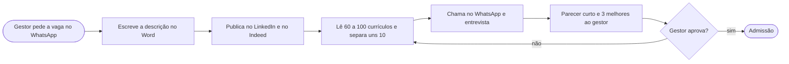
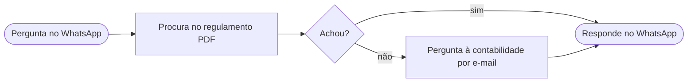

# Sobre mim: Juliana, analista de RH
Atualizado: 2026-10-26 · Fonte: entrevista /sobre-mim (respostas simuladas para teste)

## Em uma frase
Única pessoa do RH da Amorieu Doces (uns 25 funcionários entre loja, produção e escritório): recruta, admite, fecha o ponto e responde as dúvidas da equipe.

## Papel e decisões
- Analista de RH, sozinha no setor.
- Decide sozinha: quem passa da triagem de currículos e as datas de entrevista.
- Não decide: contratação e salário (gestor da área com o diretor).

## Minha semana
| Quando | O quê | Tempo |
|---|---|---|
| Segunda | Reunião com os gestores sobre vagas abertas | [a confirmar] |
| Terça a quinta | Triagem, entrevistas e admissões | [a confirmar] |
| Sexta | Ponto e pendências da folha | [a confirmar] |
| Dia 20 a 25 do mês | Fecha o ponto e manda para a contabilidade fazer a folha | [a confirmar] |
| Todo dia | Dúvidas dos funcionários no WhatsApp | uns 40 min |

## Com quem falo e por onde
- Gestores das áreas: WhatsApp e reunião.
- Candidatos: WhatsApp e e-mail.
- Contabilidade: e-mail.
- Funcionários: WhatsApp (muita dúvida de férias, holerite e benefício).

## Mapa de processos
| # | Processo | Gatilho | Passos (resumo) | Ferramentas | Entrada → Saída | Tempo | Frequência | Dor principal |
|---|---|---|---|---|---|---|---|---|
| 1 | Recrutamento e seleção | Gestor pede a vaga pelo WhatsApp | Descrição → publica → triagem → entrevista → parecer → 3 melhores ao gestor | Word, LinkedIn, Indeed, WhatsApp, e-mail, Google Planilhas | Pedido do gestor → 3 finalistas com parecer (e admissão) | umas 8 h por vaga | umas 4 vagas por mês | Ler 100 currículos e escrever a descrição da vaga do zero |
| 2 | Dúvidas dos funcionários | Mensagem no WhatsApp | Lê → procura no regulamento ou pergunta à contabilidade → responde | WhatsApp, regulamento (PDF), e-mail | Pergunta → resposta | uns 40 min por dia | umas 15 perguntas por dia | A mesma pergunta repetida e ser interrompida o dia todo |

### Processo 1: Recrutamento e seleção
1. Recebe o pedido da vaga · gestor da área · WhatsApp
2. Escreve a descrição da vaga · Juliana · Word
3. Publica a vaga · Juliana · LinkedIn e Indeed
4. Recebe 60 a 100 currículos por vaga (confeiteira, atendente, auxiliar de produção) · candidatos · LinkedIn e Indeed
5. Lê um por um e separa uns 10 · Juliana
6. Chama para entrevista · Juliana · WhatsApp
7. Entrevista · Juliana · roteiro de entrevista (Word)
8. Escreve um parecer curto de cada um · Juliana
9. Manda os 3 melhores para o gestor · Juliana → gestor
Decisões: se o gestor aprova, começa a admissão (checklist de admissão no Word); se não, volta para a triagem.

### Processo 2: Dúvidas dos funcionários
1. Chega a pergunta (férias, holerite, vale-transporte, plano de saúde, atestado) · funcionário · WhatsApp
2. Procura a resposta no regulamento interno · Juliana · PDF de 20 páginas
3. Se não acha, pergunta à contabilidade · Juliana · e-mail
4. Responde · Juliana · WhatsApp
Decisões: se a resposta está no regulamento, responde na hora; se não, espera a contabilidade.

## Documentos que deveriam estar na pasta
- Regulamento interno · PDF de 20 páginas · onde está hoje [a confirmar]
- Modelos de descrição de vaga · Word
- Roteiro de entrevista · Word
- Planilha de vagas abertas · Google Planilhas
- Checklist de admissão · Word

## Onde estão os dados / conexões possíveis
- LinkedIn e Indeed (vagas e currículos)
- Gmail (candidatos e contabilidade)
- Google Drive e Google Planilhas
- WhatsApp (gestores, candidatos, funcionários)
- Tangerino (sistema de ponto)
- Holerites em PDF que a contabilidade manda

## O que já usa de IA
Não sei [a confirmar]

## A confirmar
- Se já usa alguma IA no trabalho.
- Quanto tempo toma cada rotina da semana (reunião de segunda, fechamento do ponto do dia 20 ao 25).
- Como é o passo a passo da admissão e do fechamento do ponto (citados, não detalhados).
- Quanto tempo a contabilidade leva para responder uma dúvida.
- Equipe: `memoria/empresa.md` fala em 4 pessoas; nesta entrevista são uns 25 funcionários. Qual vale?
