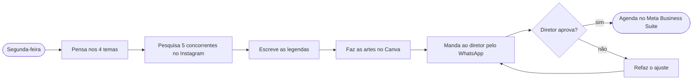
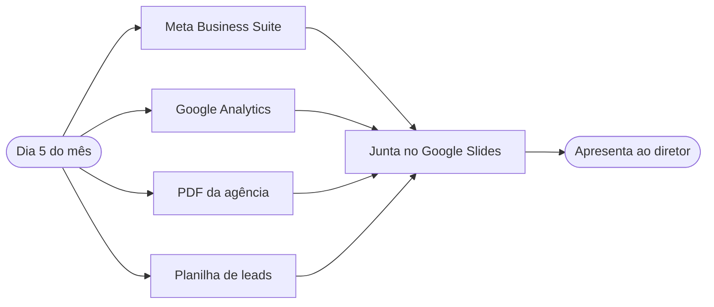

# Sobre mim: Camila, analista de marketing
Atualizado: 2026-10-26 · Fonte: entrevista /sobre-mim (respostas simuladas para teste)

## Em uma frase
Cuido sozinha do marketing da Amorieu Doces (Instagram, LinkedIn, newsletter, site e relatório), com uma agência que faz os anúncios.

## Papel e decisões
- Analista de marketing da Amorieu Doces, sozinha na área.
- Decido sozinha: o que postar e o calendário do mês.
- Não decido: verba de anúncio (quem decide é o diretor). Campanhas passam pela aprovação do diretor.

## Minha semana
| Dia | O quê | Tempo |
|---|---|---|
| Segunda | Planeja os posts da semana | [a confirmar] |
| Terça e quarta | Cria os posts no Canva e escreve as legendas | [a confirmar] |
| Quinta | Olha os resultados e fala com a agência | [a confirmar] |
| Sexta | Newsletter para os clientes e atualiza o site | [a confirmar] |
| Dia 5 do mês | Relatório mensal de marketing | um dia inteiro |

## Com quem falo e por onde
- **Agência de anúncios:** WhatsApp e reunião quinzenal.
- **Comercial:** pede material para proposta. Canal: [a confirmar]
- **Diretor:** aprova campanhas e posts (pelo WhatsApp); recebe o relatório mensal.
- **Fornecedores de produto:** pedem fotos e fichas técnicas. Canal: [a confirmar]

## Mapa de processos
| # | Processo | Gatilho | Passos (resumo) | Ferramentas | Entrada → Saída | Tempo | Frequência | Dor principal |
|---|---|---|---|---|---|---|---|---|
| 1 | Conteúdo do Instagram e do LinkedIn | Toda segunda | Temas → pesquisa 5 concorrentes → legendas → artes → aprovação do diretor → agenda | Instagram no navegador, Canva, WhatsApp, Meta Business Suite | Ideias de tema → 4 posts agendados | umas 8 h | toda semana | Ficar sem ideia de tema e pesquisar concorrente na mão |
| 2 | Relatório mensal de marketing | Dia 5 do mês | Tira números de 4 lugares → junta no Slides → apresenta | Meta Business Suite, Google Analytics, PDF da agência, planilha de leads, Google Slides | Números de 4 fontes → apresentação para o diretor | um dia inteiro | 1 vez por mês | Copiar número de 4 lugares e não saber quais leads viraram venda |

### Processo 1: Conteúdo do Instagram e do LinkedIn
1. Pensa nos temas da semana (4 posts) · Camila · [a confirmar]
2. Pesquisa o que os concorrentes estão postando (abre o Instagram de 5 concorrentes) · Camila · navegador
3. Escreve as legendas · Camila · [a confirmar]
4. Faz as artes · Camila · Canva
5. Manda para o diretor aprovar · Camila → diretor · WhatsApp
6. Agenda os posts · Camila · Meta Business Suite
Decisões: se o diretor pede ajuste, refaz e manda de novo; se aprova, agenda.

### Processo 2: Relatório mensal de marketing
1. Tira os números das redes · Camila · Meta Business Suite
2. Tira os números do site · Camila · Google Analytics
3. Tira os números dos anúncios · Camila · relatório da agência (PDF)
4. Tira os leads que chegaram pelo formulário do site · Camila · planilha Google
5. Junta tudo numa apresentação · Camila · Google Slides (modelo do relatório mensal)
6. Apresenta para o diretor · Camila → diretor
Decisões: [a confirmar]

## Documentos que deveriam estar na pasta
- Calendário editorial · Google Planilhas
- Manual da marca · PDF
- Fichas técnicas dos produtos · PDFs dos fornecedores
- Modelo do relatório mensal · Google Slides
- Lista de concorrentes · só na cabeça da Camila (ainda não existe escrita)

## Onde estão os dados / conexões possíveis
- Meta Business Suite (Instagram e Facebook: números e agendamento)
- Google Analytics (site)
- Canva (artes)
- Google Drive (arquivos)
- Planilha de leads do formulário do site (Google Planilhas)
- RD Station (e-mail marketing, newsletter)
- WhatsApp (agência e diretor)
- Navegador todo dia: Instagram dos 5 concorrentes

## O que já usa de IA
- não sei

## A confirmar
- Quanto tempo leva cada dia da semana (só o processo 1 e o relatório têm tempo).
- Por onde o comercial e os fornecedores pedem material.
- Quem são os 5 concorrentes que ela acompanha (comparar com `pesquisa/concorrentes.md`).
- Como saber quais leads viraram venda (onde o comercial registra a venda).
- Processos citados e não detalhados: newsletter de sexta (RD Station), atualização do site, material para o comercial, fotos e fichas para fornecedores, conversa semanal com a agência.
- Tamanho da equipe: a Camila fala em uns 25 funcionários; `memoria/empresa.md` diz 4 pessoas.
- Se já usa alguma IA no trabalho.
