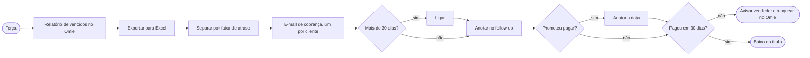
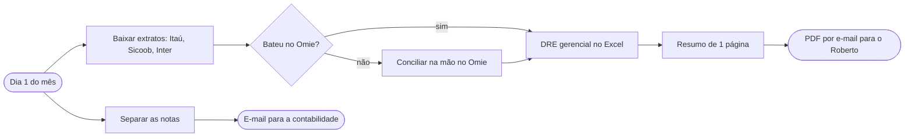

# Sobre mim: Patrícia, coordenadora financeira
Atualizado: 2026-10-26 · Fonte: entrevista /sobre-mim (respostas simuladas para teste)

## Em uma frase
Coordeno o financeiro da Amorieu Doces: pago as contas da semana, cobro quem está atrasado, concilio os bancos e entrego o fechamento do mês para o diretor.

## Papel e decisões
- **Papel:** coordenadora financeira da Amorieu Doces (doceria e cafeteria em Mogi das Cruzes: bolos, doces finos, mesas de festa e casamento, kits de doces para empresas).
- **Decide sozinha:** prorrogar boleto de cliente em até 15 dias; a ordem dos pagamentos da semana.
- **Acima disso:** o diretor (Roberto) aprova.

## Minha semana
| Quando | O quê | Tempo |
|---|---|---|
| Segunda | Contas a pagar da semana e fluxo de caixa | [a confirmar] |
| Terça a quinta | Cobrança de inadimplentes e conciliação bancária | cobrança: umas 5 h por semana |
| Sexta | Relatório para o diretor (reunião) | [a confirmar] |
| Dia 1 a 5 do mês | Fechamento mensal | uns 2 dias inteiros |

## Com quem falo e por onde
| Quem | Sobre o quê | Por onde |
|---|---|---|
| Roberto, diretor | Relatório, aprovações | Reunião na sexta e WhatsApp |
| Vendedores | Cliente atrasado | WhatsApp |
| Contabilidade externa | Arquivos do mês | E-mail |
| Empresas com kit faturado em atraso | Cobrança | E-mail e telefone |
| 2 assistentes do financeiro | [a confirmar: o que cada uma faz] | [a confirmar] |

## Mapa de processos
| # | Processo | Gatilho | Passos (resumo) | Ferramentas | Entrada → Saída | Tempo | Frequência | Dor principal |
|---|---|---|---|---|---|---|---|---|
| 1 | Cobrança de inadimplentes | Toda terça | Relatório de vencidos → Excel → faixas de atraso → e-mail um a um → ligar (+30 dias) → follow-up → bloquear quem não paga | Omie, Excel, Word, Gmail, telefone, WhatsApp | Títulos vencidos do Omie → e-mails enviados, planilha de follow-up, cliente bloqueado e vendedor avisado | Umas 5 h | Toda semana | Escrever e-mail um por um e esquecer de voltar no cliente que prometeu |
| 2 | Fechamento mensal e relatório para a diretoria | Dia 1 do mês | Extratos de 3 bancos → conciliar no Omie → DRE gerencial no Excel → resumo de 1 página → PDF para o diretor; notas para a contabilidade | Itaú, Sicoob, Inter, Omie, Excel, Gmail | Extratos OFX/Excel → DRE + resumo em PDF (Roberto) e notas (contabilidade) | Uns 2 dias inteiros | Todo mês | Conciliar na mão o que não bate e montar o resumo do zero todo mês |

### Processo 1: Cobrança de inadimplentes
1. Tirar o relatório de títulos vencidos · Patrícia · Omie
2. Exportar para Excel · Patrícia · Excel
3. Separar por faixa de atraso: até 15 dias, 15 a 30, mais de 30 · Patrícia · Excel
4. Escrever um e-mail de cobrança para cada cliente (copia o modelo e muda nome, valor e vencimento) · Patrícia · Word + Gmail
5. Ligar para os de mais de 30 dias · Patrícia · telefone
6. Anotar na planilha de follow-up · Patrícia · Excel
7. Cliente prometeu pagar: anotar a data
8. Não pagou em 30 dias: avisar o vendedor e bloquear o cliente no Omie · Patrícia · WhatsApp + Omie

Decisões: se mais de 30 dias de atraso → além do e-mail, ligar. Se prometeu pagar → anota a data. Se não paga em 30 dias → avisa o vendedor e bloqueia no Omie. Prorrogar até 15 dias: decide sozinha; acima disso, Roberto.

### Processo 2: Fechamento mensal e relatório para a diretoria
1. Baixar os extratos de Itaú, Sicoob e Inter em OFX ou Excel · Patrícia · internet banking
2. Conciliar no Omie o que não bateu · Patrícia · Omie
3. Montar o DRE gerencial · Patrícia · Excel (modelo)
4. Montar o resumo de 1 página: faturamento, despesas, caixa, inadimplência · Patrícia · Excel
5. Mandar para o diretor por e-mail, em PDF · Patrícia · Gmail
6. Separar as notas e mandar para a contabilidade · Patrícia · e-mail

Decisões: o que bate entra direto; o que não bate é conciliado na mão no Omie.

## Documentos que deveriam estar na pasta
- Modelo de e-mail de cobrança (Word) · hoje: [a confirmar, provavelmente no computador ou no Drive]
- Planilha de follow-up de cobrança (Excel) · hoje: [a confirmar]
- Modelo do DRE gerencial (Excel) · hoje: [a confirmar]
- Política de crédito (PDF de 2 páginas) · hoje: [a confirmar]

## Onde estão os dados / conexões possíveis
- **Omie (ERP, no navegador):** títulos vencidos, conciliação, bloqueio de cliente.
- **Internet banking:** Itaú, Sicoob, Inter (extratos OFX ou Excel).
- **Excel no computador:** faixas de atraso, follow-up, DRE, resumo.
- **Gmail:** cobrança, envio do PDF ao diretor, arquivos para a contabilidade.
- **Google Drive da empresa.**
- **WhatsApp:** diretor e vendedores.

## O que já usa de IA
Não sei.

## A confirmar
- O que fazem as 2 assistentes do financeiro (parte da cobrança ou da conciliação passa por elas?).
- Tempo da segunda (contas a pagar e fluxo de caixa) e da sexta (relatório).
- "Não paga em 30 dias": 30 dias depois da promessa ou do vencimento?
- O que acontece quando o cliente paga (baixa no Omie, quem faz).
- Onde ficam hoje os 4 documentos (computador ou Drive).
- Contas a pagar e fluxo de caixa: citados, não detalhados (bom candidato a próximo processo).
- `memoria/empresa.md` fala em 4 pessoas na equipe; aqui são uns 25 funcionários entre loja, produção e escritório. Qual vale?
