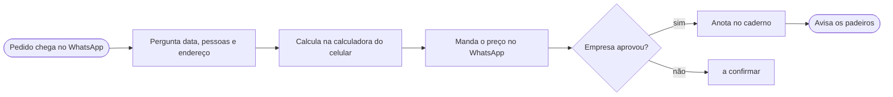
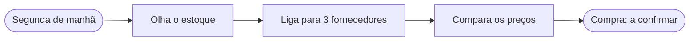

# Sobre mim: Jorge, dono da Padaria Trigo Azul
Atualizado: 2026-10-25 · Fonte: entrevista /sobre-mim

## Em uma frase
Dono da Padaria Trigo Azul (Campinas). Cuida das compras, dos preços e da escala e atende pedidos de café da manhã para empresas.

## Papel e decisões
- Dono da Padaria Trigo Azul, em Campinas.
- Decisões só dele: compras, preços e escala.

## Minha semana
| Dia | O quê | Tempo |
|---|---|---|
| Todo dia | Abre a padaria às 6h | [a confirmar] |
| Segunda (manhã) | Faz as compras da semana | 2 horas |
| Sexta | Fecha o caixa da semana | [a confirmar] |

## Com quem falo e por onde
| Com quem | Por onde |
|---|---|
| Equipe (padeiros) | Pessoalmente |
| Fornecedores | WhatsApp (as compras ele faz por ligação) |
| Empresas (clientes do café da manhã) | WhatsApp |

## Mapa de processos
| # | Processo | Gatilho | Passos (resumo) | Ferramentas | Entrada → Saída | Tempo | Frequência | Dor principal |
|---|---|---|---|---|---|---|---|---|
| 1 | Pedido de café da manhã para empresa | Pedido chega pelo WhatsApp | Pergunta data, pessoas e endereço → calcula → manda o preço → se aprovar, anota e avisa os padeiros | WhatsApp, calculadora do celular, caderno | Pedido da empresa → pedido anotado + padeiros avisados | ~20 min | 5x por semana | Perde pedido anotado no caderno |
| 2 | Compras da semana | Segunda de manhã | Olha o estoque → liga para 3 fornecedores → compara preço | Telefone | Estoque → compra feita [a confirmar] | 2 horas | 1x por semana | Não sabe se está pagando caro |

### Processo 1: Pedido de café da manhã para empresa
1. Recebe o pedido · empresa → Jorge · WhatsApp
2. Pergunta data, número de pessoas e endereço · Jorge · WhatsApp
3. Calcula o preço · Jorge · calculadora do celular
4. Manda o preço · Jorge · WhatsApp
5. Se aprovar: anota o pedido · Jorge · caderno
6. Avisa os padeiros · Jorge → equipe · pessoalmente [a confirmar]

Decisões: se a empresa aprovar, anota e avisa os padeiros. Se não aprovar, [a confirmar].

### Processo 2: Compras da semana
1. Olha o estoque · Jorge · [a confirmar]
2. Liga para 3 fornecedores · Jorge · telefone
3. Compara os preços · Jorge · [a confirmar]

Decisões: como escolhe o fornecedor depois de comparar, [a confirmar].

## Documentos que deveriam estar na pasta
| Documento | Onde está hoje |
|---|---|
| Lista de preços | Papel na parede da padaria |
| Caderno de pedidos | Caderno de papel |

## Onde estão os dados / conexões possíveis
- WhatsApp: pedidos das empresas e conversa com fornecedores.
- Caderno: pedidos aprovados.
- Não usa planilha.

## A confirmar
- O que acontece quando a empresa não aprova o preço.
- Como avisa os padeiros (pessoalmente?).
- Como olha o estoque (contagem, anotação?).
- Como escolhe o fornecedor e como faz o pedido depois de comparar.
- Quanto tempo leva o fechamento do caixa de sexta e como ele é feito.
- Como define a escala da equipe.
