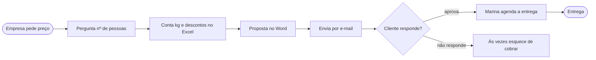
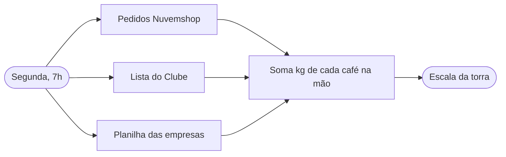

# Sobre mim: Helena, fundadora e mestre de torra da Torra Viva Cafés Especiais
Atualizado: 2026-10-25 · Fonte: entrevista /sobre-mim (respostas simuladas de teste; empresa fictícia)

## Em uma frase
Fundadora e mestre de torra da Torra Viva Cafés Especiais: planeja e faz a torra, atende empresas e fecha o caixa.

## Papel e decisões
- Fundadora da Torra Viva Cafés Especiais e mestre de torra.
- Decisões só dela: preço, compra de café verde e contratação.

## Minha semana
| Dia | O quê | Tempo |
|---|---|---|
| Segunda (manhã, a partir das 7h) | Planeja a torra | ~2 h |
| Terça | Torra | dia todo |
| Quarta | Atende empresas, faz orçamentos, fecha o caixa | [a confirmar] |
| Quinta | Torra | dia todo |
| Sexta | Atende empresas, faz orçamentos, fecha o caixa | [a confirmar] |

## Com quem falo e por onde
| Com quem | Por onde | Frequência |
|---|---|---|
| Equipe | WhatsApp | [a confirmar] |
| Produtores de café | Telefone | [a confirmar] |
| Empresas (clientes) | E-mail e WhatsApp | [a confirmar] |
| Contadora | [a confirmar] | 1 vez por mês |

## Mapa de processos
| # | Processo | Gatilho | Passos (resumo) | Ferramentas | Entrada → Saída | Tempo | Frequência | Dor principal |
|---|---|---|---|---|---|---|---|---|
| 1 | Orçamento para escritório | Empresa pede preço por e-mail ou WhatsApp | Pergunta nº de pessoas → conta kg e descontos na planilha → proposta no Word → envia por e-mail → aprovado: Marina agenda entrega | Gmail, WhatsApp Business, Excel, Word | Pedido de preço → proposta por e-mail para a empresa | ~40 min | ~6 vezes/semana | Demora e esquece o follow-up |
| 2 | Planejamento da torra | Toda segunda, 7h | Olha pedidos da Nuvemshop, lista do Clube e planilha das empresas → soma kg de cada café na mão → monta a escala da torra | Nuvemshop, lista do Clube, planilha das empresas | Pedidos → escala da torra da semana | ~2 h | 1 vez/semana | Conta na mão; já faltou café do Clube |

### Processo 1: Orçamento para escritório
1. Recebe o pedido de preço · empresa · e-mail ou WhatsApp
2. Pergunta quantas pessoas tem o escritório · Helena · e-mail ou WhatsApp
3. Abre a planilha de preços e faz a conta do kg e dos descontos · Helena · Excel
4. Escreve a proposta no modelo · Helena · Word
5. Manda a proposta · Helena · e-mail
6. Se aprovado: agenda a entrega · Marina · [a confirmar]

Decisões: se o cliente aprova, a Marina agenda a entrega; se não responde, às vezes a cobrança (follow-up, a mensagem de retomar o contato) fica esquecida.

### Processo 2: Planejamento da torra
1. Olha os pedidos da loja online · Helena · Nuvemshop
2. Olha a lista do Clube · Helena · [a confirmar onde fica]
3. Olha a planilha das empresas · Helena · [a confirmar qual planilha]
4. Soma os kg de cada café · Helena · na mão
5. Monta a escala da torra · Helena · [a confirmar onde]

## Documentos que deveriam estar na pasta
| Documento | Onde está hoje |
|---|---|
| Tabela de preços | Excel, no computador da Helena |
| Modelo de proposta | Word |
| Relatório mensal de vendas | Google Planilhas |

## Onde estão os dados / conexões possíveis
- Google Drive
- Nuvemshop (loja online)
- Gmail
- WhatsApp Business

## A confirmar
- Quanto tempo levam os atendimentos e o fechamento de caixa de quarta e sexta.
- Como a Helena fala com a contadora.
- Como a Marina agenda a entrega (ferramenta).
- Onde ficam a lista do Clube e a planilha das empresas, e onde a escala da torra é registrada.
- Dados da empresa em `memoria/empresa.md` (vazio: rodar `/instalar`).
